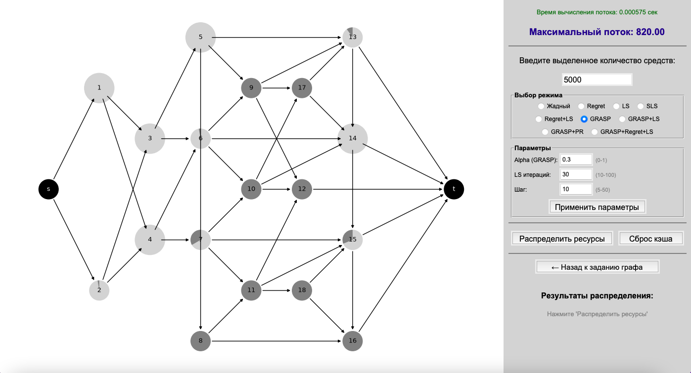
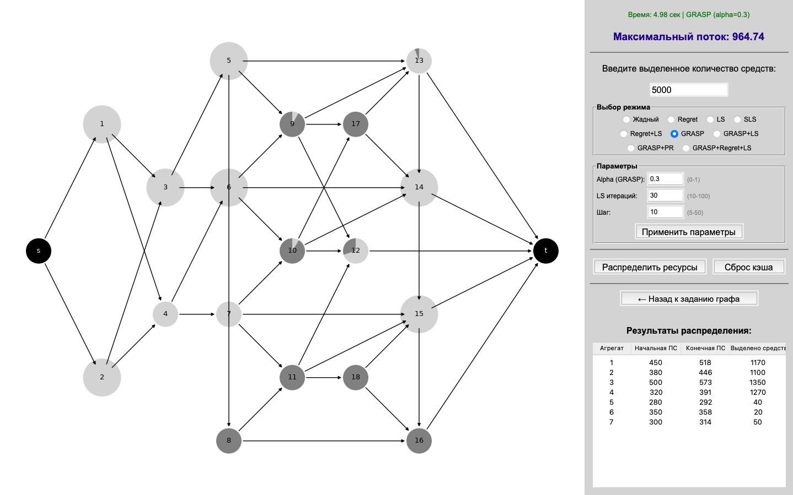

# Распределение ресурсов в транспортных сетях

Программный комплекс для распределения ограниченного бюджета между вершинами транспортной сети с целью максимизации максимального потока из источника в сток.

## Возможности

- Ввод данных вручную или импорт из Excel.
- Визуализация графа с загрузкой вершин.
- 9 алгоритмов распределения ресурсов.
- Настройка параметров (α для GRASP, итерации LS, шаг).
- Таблица результатов и замер времени работы.

## Файлы проекта

### `main.py` — единственный файл приложения

Содержит весь код: алгоритмы, интерфейс и визуализацию. Основные классы:

- **`Dinic`** — алгоритм Диница для вычисления максимального потока. Методы `bfs`, `dfs`, `max_flow`.
- **`FlowNetworkApp`** — главный класс приложения: интерфейс, алгоритмы распределения, отрисовка графа.

### `requirements.txt` — зависимости проекта.

## Как работает

### 1. Запуск и ввод данных

При запуске открывается стартовое окно с двумя кнопками:
- **«Задать данные для графа»** — ручной ввод (число вершин, пропускные способности, связи, координаты).
- **«Взять данные для графа из файла»** — импорт из Excel (колонки: `Число вершин`, `Пропускная способность`, `Связи`, `Координаты`).

<!-- СКРИНШОТ: стартовое окно -->


### 2. Построение графа и расчёт потока

После ввода данных вызывается `drawgraph()`:
- Строится ориентированный граф `NetworkX`.
- Вершины расщепляются на `v_in → v_out` с ёмкостью `cap[v]`.
- Вычисляется максимальный поток алгоритмом Диница.
- Открывается окно с графом и панелью управления.

### 3. Выбор алгоритма и распределение

На панели справа:
- Поле ввода бюджета (по умолчанию 5000).
- Выбор одного из 9 режимов.
- Параметры: Alpha (GRASP), LS итераций, Шаг.
- Кнопка **«Распределить ресурсы»**.



Все алгоритмы работают по одной схеме: на каждом шаге перебирают вершины-кандидаты, оценивают прирост потока при вложении `step` средств и выбирают лучшую (или случайную из RCL для GRASP). Пропускная способность растёт по формуле:

```
cap[v] = cap₀[v] + 2 * √(вложено[v])
```

| Режим | Суть |
|---|---|
| Жадный | Лучший прирост потока |
| Regret | Учёт «сожаления» (разница с лучшим) |
| LS | Локальный поиск: перераспределение между вершинами |
| SLS | Стохастический поиск с tabu-list |
| Regret+LS | Regret, затем локальный поиск |
| GRASP | Случайный выбор из RCL |
| GRASP+LS | GRASP + локальный поиск |
| GRASP+PR | GRASP + Path Relinking |
| GRASP+Regret+LS | Комбинированная схема |

### 4. Результаты

После распределения:
- Граф перерисовывается с обновлёнными диаграммами.
- В правой панели появляется таблица: агрегат, начальная ПС, конечная ПС, выделено средств.
- Отображается максимальный поток и время работы.


